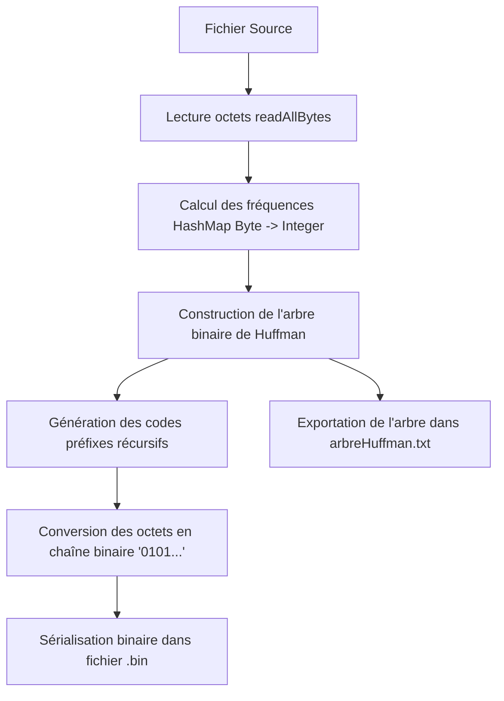
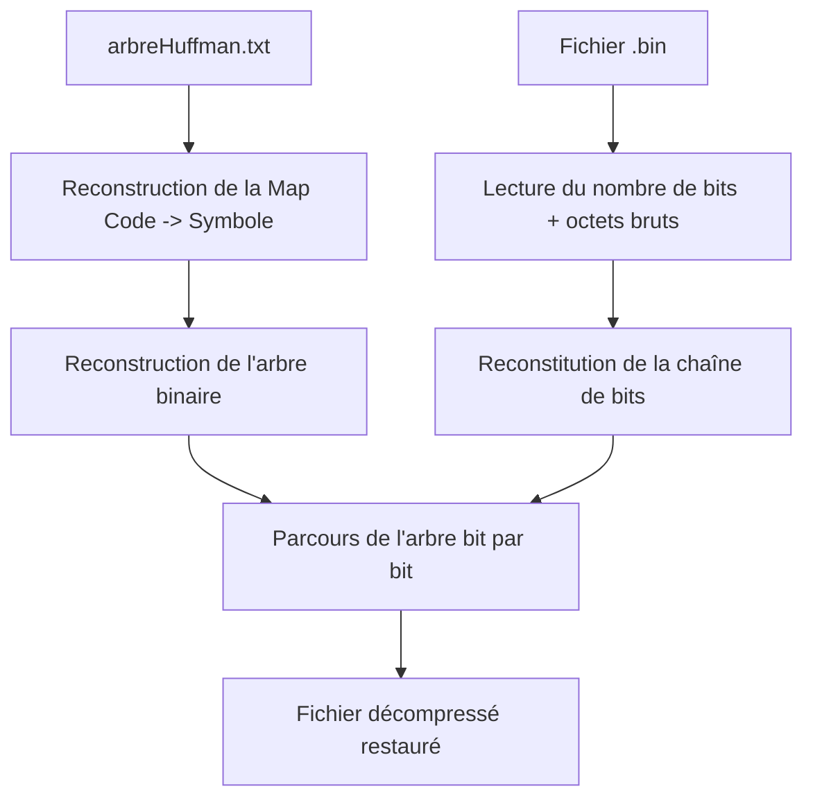

# Architecture et Algorithmes

Le projet implémente l'algorithme classique de compression sans perte de **David Huffman (1952)**, opérant au niveau octet (`byte`).

---

## 1. Vue d'ensemble des modules

Le projet est divisé en packages sous `fr.iutrodez.compresseurhuffman` :

```
fr.iutrodez.compresseurhuffman
│   ├── ApplicationLigneCommande.java   // Point d'entrée principal (Menu interactif ou CLI)
│   ├── ArgumentLigneCommande.java      // Parseur et exécuteur des commandes CLI
│
├── huffman
│   ├── CompressionHuffman.java         // Logique de compression et calcul de l'arbre
│   └── DecompressionHuffman.java       // Logique de reconstruction de l'arbre et décompression
│
├── objets
│   └── Noeud.java                      // Représentation d'un nœud dans l'arbre binaire
│
└── outils
    ├── GestionFichier.java             // I/O binaires et textuels
    ├── GestionPrompt.java              // Saisies interactives utilisateur (Scanner)
    ├── GestionUrl.java                 // Validation et manipulation de chemins/fichiers
    └── StatistiquesCompresseur.java    // Métriques (taux de compression, durée)
```

---

## 2. Processus de Compression



### Étapes clés :
1. **Comptage des fréquences** : Calcul du nombre d'apparitions de chaque octet dans une `HashMap<Byte, Integer>`.
2. **Construction de l'arbre** :
   - Chaque octet forme initialement une feuille (`Noeud`).
   - À chaque étape, les 2 nœuds ayant les fréquences les plus basses sont extraits et combinés sous un nouveau nœud parent dont la fréquence est la somme de ses enfants.
   - Le processus se répète jusqu'à obtenir un nœud racine unique.
3. **Génération des codes binaires** :
   - Parcours en profondeur (DFS) depuis la racine : branche gauche = `'0'`, branche droite = `'1'`.
   - Les symboles les plus fréquents ont les codes les plus courts.
4. **Écriture binaire** :
   - Écriture d'un entier 32 bits (`writeInt`) pour stocker le nombre exact de bits utiles.
   - Regroupement des bits sous forme d'octets avec décalage de bits (`1 << (7 - (i % 8))`).

---

## 3. Processus de Décompression



1. **Chargement de la table** : Lecture du fichier `arbreHuffman.txt` et réinjection dans l'arbre binaire de décompression.
2. **Lecture des bits** : Lecture de la longueur en bits et reconstruction de la séquence.
3. **Navigation dans l'arbre** :
   - Pour chaque bit, on descend à gauche (`'0'`) ou à droite (`'1'`).
   - Dès qu'une feuille est atteinte, l'octet correspondant est émis, et on repart de la racine.

---

## 4. Formats de Fichiers

### 4.1 Fichier compressé (`.bin`)
- **En-tête (4 octets)** : `longueurBits` (entier standard signé 32 bits, écrit via `DataOutputStream.writeInt`).
- **Corps de données** : $\lceil \text{longueurBits} / 8 \rceil$ octets représentant les bits compressés consécutifs.

### 4.2 Fichier d'arbre (`arbreHuffman.txt`)
Fichier texte au format clé/valeur :
```text
codeHuffman = 00 ; encode = 01100001 ; symbole = a
codeHuffman = 010 ; encode = 01100010 ; symbole = b
...
```
